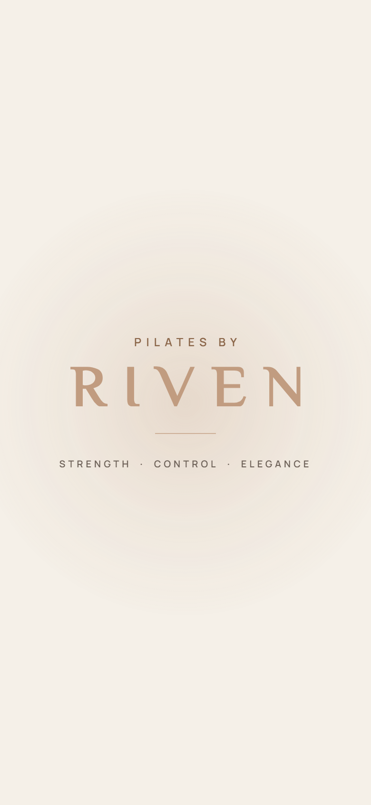
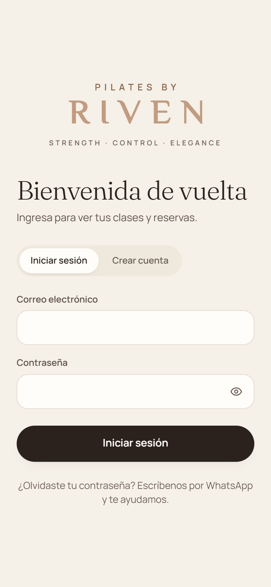
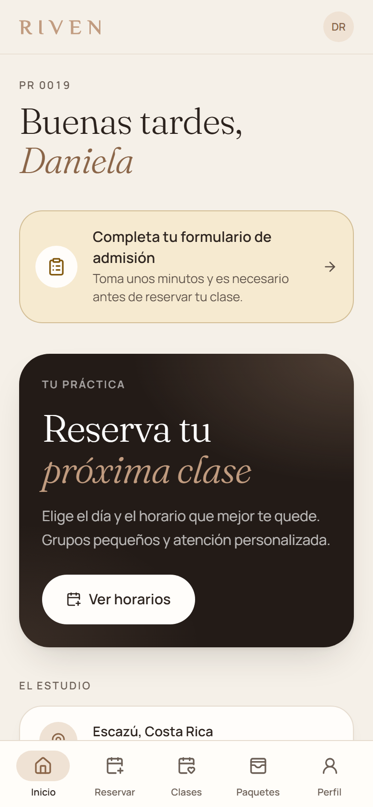
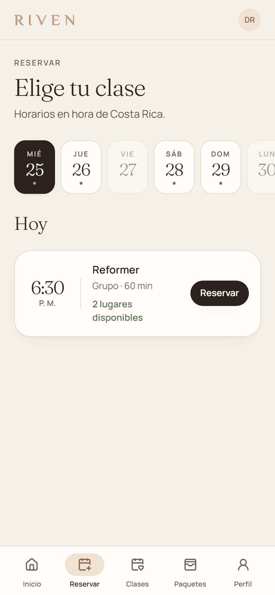
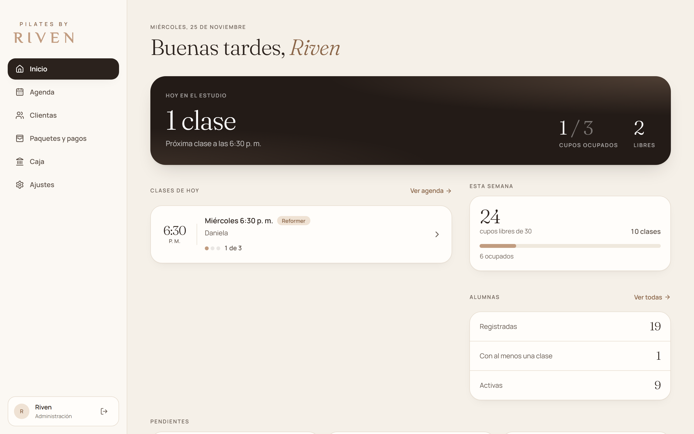
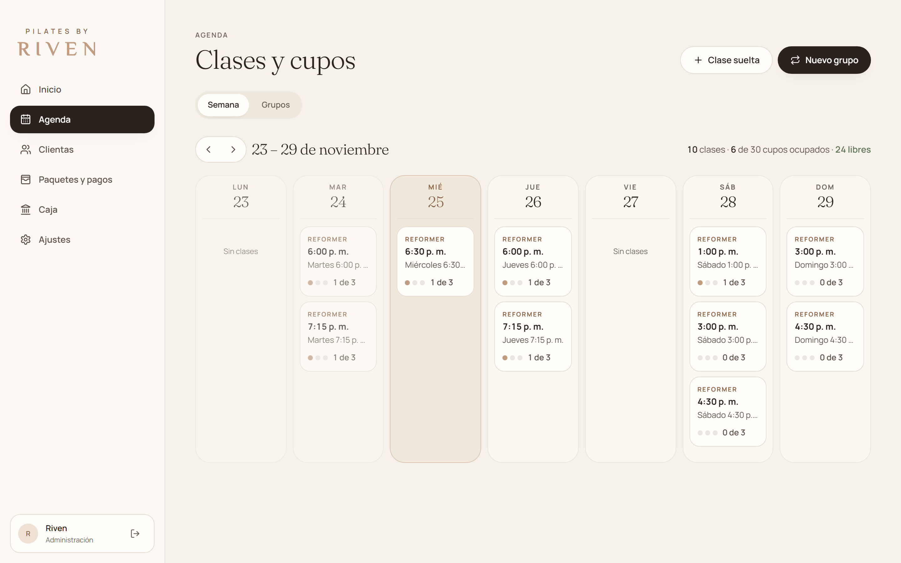

<div align="center">

<br>


<br><br>

**Reservas, pagos y administración del estudio Pilates by Riven**<br>
<sub>Escazú, Costa Rica · Strength · Control · Elegance</sub>

<br>

[](https://app.pilatesbyriven.com)


</div>

<br>

<table>
<tr>
<td width="25%"></td>
<td width="25%"></td>
<td width="25%"></td>
<td width="25%"></td>
</tr>
<tr>
<td align="center"><sub><b>Abertura animada</b></sub></td>
<td align="center"><sub><b>Acesso</b></sub></td>
<td align="center"><sub><b>Início da clienta</b></sub></td>
<td align="center"><sub><b>Reservar</b></sub></td>
</tr>
</table>

<table>
<tr>
<td width="50%"></td>
<td width="50%"></td>
</tr>
<tr>
<td align="center"><sub><b>Painel · Início do dia</b></sub></td>
<td align="center"><sub><b>Painel · Agenda da semana</b></sub></td>
</tr>
</table>

<sub>Capturas com dados fictícios de demonstração.</sub>

---

## ✨ O que o app faz

<table>
<tr>
<td width="50%" valign="top">

### 🧘‍♀️ Para a clienta
- **Abertura de marca** animada, rápida e que se pula com um toque
- **Cadastro** com confirmação de e-mail por código ou **entrada com Google**
- **Formulário de admissão** e consentimento, com rascunho salvo
- **Reservar e cancelar** aulas, com lista de espera
- **Comprar pacotes** e enviar o comprovante SINPE
- Instala no celular como app (**PWA**), funciona em iPhone e Android

</td>
<td width="50%" valign="top">

### 🗂️ Para o estúdio
- **Início do dia:** aulas de hoje, vagas e pendências
- **Agenda** semanal, grupos fixos, presença com um toque
- **Clientas:** fichas, histórico, admissões a revisar
- **Pacotes e pagamentos:** créditos, parciais, reembolsos, USD e CRC
- **Caja** e fundo Lindora, exportação CSV
- Papéis separados: **administração** e **instrutora**

</td>
</tr>
</table>

## 🔒 Segurança e privacidade

| Área | Proteção |
|---|---|
| **Respostas de saúde** | Criptografadas (AES-256-GCM); só a administração lê, com registro de cada acesso |
| **Contas** | Senhas com scrypt, sessões JWT, limite de tentativas, contas não confirmadas apagadas em 48 h |
| **Comprovantes** | Fora da pasta pública, só saem por rota de administração |
| **Navegador** | Política de segurança de conteúdo (CSP), HTTPS automático, cabeçalhos com helmet |
| **Dados** | Backup diário do banco e dos comprovantes, restauração ensaiada |

> [!IMPORTANT]
> Guarde uma cópia da chave `INTAKE_KEY` fora do servidor: sem ela as respostas de admissão já salvas não podem ser lidas.

> [!NOTE]
> O texto da declaração (`CONSENT_TEXT` em `server/src/services/intake.js`) e o aviso de privacidade são rascunhos
> pendentes de revisão jurídica na Costa Rica. Ao mudar o texto ou as perguntas, suba `CONSENT_VERSION` / `FORM_VERSION`:
> quem já preencheu passa a "requer atualização".

## 🧪 Qualidade

| Camada | Como | Resultado |
|---|---|---|
| **Servidor** | `node:test` contra PostgreSQL real | **76 testes** ✓ |
| **Interface** | Playwright em computador (1440 px) e celular (Pixel 7) | **40 cenários** ✓ |
| **Carga** | 1000 clientas virtuais simultâneas + 3 admins, 17 regras conferidas no banco | ✓ |
| **Uso real** | Agentes usando o app como clienta nova, clienta com rede ruim e a dona do estúdio | defeitos corrigidos |

<details>
<summary><b>O que os testes cobrem</b></summary>

<br>

- **Servidor:** cadastro, permissões, último cupo e fuso horário, além dos casos de aceitação do documento de requisitos:
  - renovação com pagamento parcial confirmada uma única vez;
  - quatro aulas e uma reposição;
  - ausência e cancelamento conforme a regra do pacote;
  - fechamento de Caja do exemplo (US$2.400 cobrados, US$900 de gastos, US$1.500 disponíveis, US$1.200 transferidos).
- **Admissão:** passo obrigatório antes de reservar; as respostas clínicas não vazam para ficha, agenda, Caja nem exportações.
- **Confirmação de e-mail e Google:** `verification.test.js`.
- **Defeitos encontrados pelos agentes:** fixados em `fixes.test.js`.
- **Interface:** cada cenário confere erros de JavaScript e estouro de largura; no celular, também botões pequenos demais para o dedo.

</details>

```bash
cd server && npm test      # servidor
npm run test:e2e           # interface (relatório em e2e/report/)
cd server && npm run simulate   # 1000 usuárias (SIM_USERS=200 SIM_SEED=7 para variar)
```

## 🚀 Rodar local

```bash
# 1. Banco de desenvolvimento (cluster próprio na porta 5433)
powershell -File scripts/db-start.ps1

# 2. API (porta 3001), que migra o banco ao iniciar
cd server
npm install
npm run seed:demo     # admin + catálogo + grupos + clientas fictícias
npm run dev

# 3. Front (porta 3000), com /api redirecionado para a 3001
npm install
npm run dev
```

O login de administração vem de `ADMIN_EMAIL` / `ADMIN_PASSWORD` em `server/.env` (arquivo local, fora do git).
Modelo de configuração: `server/.env.example`.

## 🌐 Publicação

Docker Compose com três serviços: **Caddy** (HTTPS automático), **app** (API + front) e **PostgreSQL**.

```bash
bash deploy/publish.sh pilates-vps                      # publica a versão do commit atual
node e2e/smoke.mjs https://app.pilatesbyriven.com       # confere o endereço publicado
```

O roteiro completo, com backup, restauração, e-mail e Google, está em [deploy/README.md](deploy/README.md).

## 📱 App de iPhone

O mesmo app, empacotado com **Capacitor**, com login nativo "Continuar con Apple" e "Continuar con Google", folha de compartilhar do iOS
e tela de arranque da marca. O projeto do Xcode está em `ios/`. Num Mac:

```bash
npm install
npm run build:ios   # compila as telas e copia para o projeto iOS
npm run ios         # abre no Xcode
```

O passo a passo até a App Store (conta Apple, Xcode, Google no iPhone, cadastro, capturas, envio e riscos de recusa) está em
**[docs/APP_STORE.md](docs/APP_STORE.md)**.

## 🗺️ Estrutura

```
server/
  migrations/         SQL versionado (001 núcleo … 005 confirmação de e-mail e Google)
  src/routes/         auth, client (clienta), admin (painel), commerce (pacotes, pagamentos, Caja)
  src/services/       reservas, pacotes, sessões, ajustes, verification, google
  src/lib/mail.js     envio de e-mail (SMTP; em dev grava num arquivo)
  test/               testes de integração
src/
  app/Intro.jsx       abertura animada da marca
  app/Shell.jsx       barra lateral (computador) e barra inferior (celular)
  ui/                 design system (botões, cartões, folha modal, toasts, check de sucesso)
  screens/admin/      Inicio, Agenda, Reservas, Clientas, Paquetes y pagos, Caja, Ajustes
  screens/client/     Inicio, Reservar, Mis clases, Paquetes, Perfil
deploy/               Docker Compose, Caddy, publish / backup / restore
e2e/                  testes Playwright e conferência de produção
docs/screens/         capturas deste README
```

## 📍 Estado

| Fase | Conteúdo | |
|---|---|:---:|
| **1** | PostgreSQL, modelo de dados, autenticação e papéis, design system, agenda, reservas, fichas | ✅ |
| **2** | Pacotes e créditos, renovações, pagamentos (parcial, por verificar, reembolso, CRC/USD), Caja, CSV | ✅ |
| **3** | Admissão e consentimento criptografados, compra pela clienta, comprovante SINPE | ✅ |
| **4** | Testes de carga, interface e agentes · publicação na VPS · abertura animada | ✅ |
| | Confirmação de e-mail e Google (prontos, aguardam SMTP e client ID) | 🟡 |
| | App iPhone: projeto e login com Apple prontos; falta compilar no Mac e enviar | 🟡 |

O histórico dia a dia e a lista completa do que falta estão em **[HISTORICO.md](HISTORICO.md)**.

<br>

<div align="center">
<sub>Feito com cuidado para o estúdio Pilates by Riven · Escazú, Costa Rica</sub>
</div>
